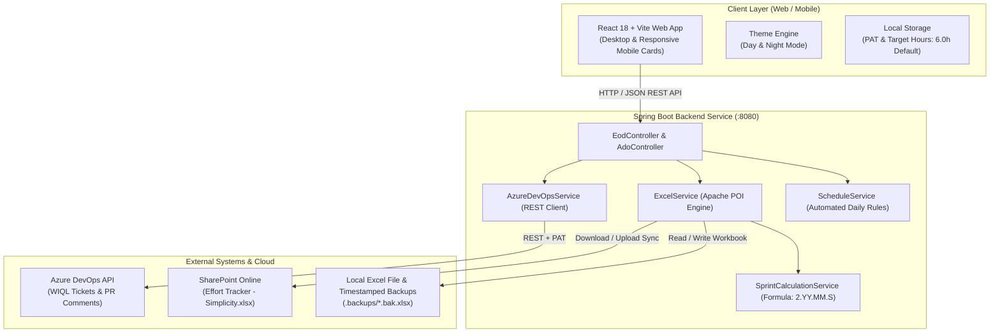

# Simplicity EOD Updater — Comprehensive Project Documentation

## 1. Executive Summary & Project Purpose

The **Simplicity EOD Updater** is an enterprise-grade pair-programming full-stack application engineered to streamline, automate, and centralize the daily End-Of-Day (EOD) effort tracking for software engineering teams working on the **SimplicityCollect** platform (`simplicitysystems`).

### The Core Problem It Solves
Historically, software developers and team members manually tracked daily effort by opening a shared cloud Excel spreadsheet (`Effort Tracker - Simplicity.xlsx`) on SharePoint Online:
1. **Manual Overhead & Errors**: Developers had to manually look up Azure DevOps ticket numbers, calculate sprint sheet names, calculate recurring meeting times, divide remaining hours across tickets, and manually enter rows one by one.
2. **Formula & Formatting Corruption**: Concurrent edits on Excel Online often corrupt cell formatting, date parsing, or break formula tracking.
3. **Compliance & Visibility Gaps**: Managers lacked immediate intelligence on who logged hours, whether 6.0/8.0 hours were met, which tickets consumed excess effort, and where missing entries occurred.
4. **Mobile Inaccessibility**: Excel Online on smartphones is cumbersome, making it difficult for engineers to log effort while away from their desks.

### The Solution
The **Simplicity EOD Updater** provides a unified, mobile-first Web UI (React + Vite) coupled with a robust Spring Boot microservice. It bridges **Azure DevOps**, **SharePoint Online**, and **Excel (Apache POI)** into a 1-click automated logging pipeline.

---

## 2. High-Level Architecture & Data Flow



---

## 3. Key Features Deep Dive

### 3.1. Azure DevOps Live Work Item Integration
* **Automated Ticket Fetching**: Uses Azure DevOps REST APIs and WIQL (Work Item Query Language) to retrieve tickets assigned to the logged-in engineer that are in `Development` state.
* **PR Review Comment Detection**: Inspects active Pull Requests for the user in `simplicitysystems/SimplicityCollect`. Tickets with open PR comments are automatically tagged with the `PR comments` category.
* **Equal Hours Auto-Distribution**: Check any combination of tickets, and the system divides the available developer hours equally across all selected tickets in clean half-hour intervals (`0.5h`, `1.0h`, `1.5h`, etc.).

### 3.2. Automated Daily Recurring Calls & Meeting Rules
Depending on the day of the week, the system automatically detects recurring standups and pre-populates calls, leaving the exact remainder for ticket work:
* **Monday – Wednesday**:
  * `0.5h` Internal Standup (`Internal calls`)
  * `1.0h` Technical and Standup Calls (`Client calls`)
  * *Leaves 4.5h for tickets (based on 6.0h target)*.
* **Thursday**:
  * `0.5h` Internal Standup (`Internal calls`)
  * `1.0h` Technical and Standup Calls (`Client calls`)
  * `1.0h` Office Hours Call (`Client calls`)
  * *Leaves 3.5h for tickets*.
* **Friday**:
  * `0.5h` Internal Standup (`Internal calls`)
  * `0.5h` Technical Training Call (`Client calls`)
  * *Leaves 5.0h for tickets*.

### 3.3. Configurable Daily Total Hours & Non-Negative Badging
* **6.0 Hours Default**: Configured with 6.0 hours as the daily target (customizable to 7.0, 8.0, etc.).
* **Editable in Real-Time**: Click the target hours field on the Daily Total bar to change the daily target. Changes persist automatically in browser `localStorage` (`eod_target_daily_hours`).
* **Non-Negative Badge Feedback**:
  * When logged hours < target: Displays `X.Xh remaining` (e.g., `1.5h remaining`).
  * When logged hours == target: Displays `🎯 Perfect 6.0h Day`.
  * When logged hours > target: Instead of displaying negative numbers (e.g. `-1.5h remaining`), it displays **`🎯 +1.5h extra`** with a green success badge.

### 3.4. SharePoint Online Live Cloud Synchronization
* **Direct Cloud Write**: Syncs task rows directly to the live cloud file on SharePoint (`psiog0-my.sharepoint.com`) using Microsoft Graph / SharePoint Web Endpoints.
* **Dual Persistence**: Saves to both the local disk file and pushes directly to the cloud SharePoint tracker simultaneously.
* **Automated Backups**: Creates a timestamped `.bak.xlsx` backup in the `.backups/` directory before every write operation to guarantee zero data loss.

### 3.5. Automated Sprint Sheet Calculation
Calculates the active sprint name dynamically based on the project's formula:
$$\text{Sprint Name} = 2.\langle\text{year\_offset}\rangle.\langle\text{month}\rangle.\langle\text{sprint\_index}\rangle$$
*(e.g., `2.14.10.1` represents year offset 14 [2026], October, 1st sprint)*.

### 3.6. Mobile-First Responsive Design (Smartphone Friendly)
* **Mobile Task Cards**: On screens $\le 768\text{px}$ and $\le 480\text{px}$, the desktop spreadsheet table transforms into clean, touch-friendly task cards.
* **Full-Width Form Controls**: Ticket ID input boxes and Work Category dropdowns expand to 100% width with clear field labels, 44px touch targets, and non-repeating custom SVG chevrons.
* **Zero Horizontal Scroll**: All fields (Ticket, Category, Hours Stepper, Description, Duplicate, Delete) fit cleanly in mobile viewports without horizontal scrolling.

### 3.7. Team Performance & Effort Analytics Dashboard
A dedicated managerial analytics suite featuring:
* **Executive KPIs**: Total logged hours, active sprint name, team velocity, and overall productivity ratio.
* **Leaderboards & Rankings**: Top velocity contributors, highest effort ratio, and overhead hours distribution.
* **Quality & Compliance Audits**: Flags missing logs, missing categories/descriptions, and over/under-logged days.
* **Missing Log Reason Dialog**: Allows developers and managers to document official reasons for missing log days directly into `missing_log_reasons.json`.
* **Individual Developer Deep-Dive**: Filterable view providing daily effort logs, category breakdowns, and ticket spotlights for each developer.
* **Story Points vs. Logged Effort Analytics**: Compares Azure DevOps story points against actual Excel logged hours to measure estimation accuracy.

---

## 4. Technical Stack & File Architecture

### 4.1. Technology Matrix
| Domain | Technology | Details |
| :--- | :--- | :--- |
| **Backend** | Java 17 LTS | Spring Boot 3.2.5, Spring Web |
| **Excel Engine** | Apache POI 5.2.5 | OOXML (`XSSFWorkbook`), cell styling, date formats |
| **Frontend** | React 18 + Vite 8 | Single Page Application (SPA), fast HMR |
| **Styling** | Vanilla CSS | Bespoke design system, glassmorphism, responsive queries |
| **Icons & Effects** | Lucide React + Canvas Confetti | Modern iconography & celebratory completion animations |
| **Cloud Hosting** | Netlify (Frontend) + Render (Backend) | Automated CI/CD deployments on Git push to `main` |

---

### 4.2. File & Directory Breakdown

```
EodUpdater/
├── backend/                               # Spring Boot Application
│   ├── src/main/java/com/eod/updater/
│   │   ├── EodUpdaterApplication.java     # Application entry point
│   │   ├── controller/
│   │   │   ├── EodController.java         # EOD submission, sheets, file status, analytics
│   │   │   └── AdoController.java         # ADO tickets, schedules, config management
│   │   ├── service/
│   │   │   ├── ExcelService.java          # Core Apache POI engine (1300+ lines)
│   │   │   ├── AzureDevOpsService.java    # ADO REST API client with PAT persistence
│   │   │   ├── ScheduleService.java       # Daily recurring rules & target hours
│   │   │   └── SprintCalculationService.java # Formula-based sprint name generator
│   │   └── model/                         # 24 Data transfer & analytics objects
│   ├── pom.xml                            # Maven build configuration
│   └── Dockerfile                         # Production containerization
├── frontend/                              # React + Vite Application
│   ├── src/
│   │   ├── components/
│   │   │   ├── Header.jsx                 # Top bar, theme switch, live pills
│   │   │   ├── DailyTaskForm.jsx          # Daily logging form & mobile task cards
│   │   │   ├── DashboardView.jsx          # Managerial analytics & compliance suite
│   │   │   ├── AdoTicketSelector.jsx      # Azure DevOps ticket selector card
│   │   │   ├── FileUploadSection.jsx      # Direct sync & upload/download modes
│   │   │   └── ConfigModal.jsx            # Settings modal for ADO PAT & file paths
│   │   ├── services/api.js                # REST client for backend endpoints
│   │   ├── utils/
│   │   │   ├── hoursUtils.js              # Half-hour rounding & equal distribution
│   │   │   └── sprintUtils.js             # Client-side sprint formulas
│   │   ├── App.jsx                        # Root React component
│   │   ├── App.css                        # Design system & responsive layout (7000+ lines)
│   │   └── index.css                      # Global theme variables & tokens
│   ├── package.json                       # Node dependencies & Vite build scripts
│   └── vite.config.js                     # Vite bundler configuration
├── .backups/                              # Auto-generated Excel safety backups
├── Effort Tracker - Simplicity.xlsx       # Local master spreadsheet
├── pull_sharepoint.ps1                    # PowerShell utility to fetch SharePoint file
├── sync_sharepoint.ps1                    # PowerShell utility to push to SharePoint
├── test_sharepoint.ps1                    # PowerShell endpoint connectivity test
├── start.bat                              # Dual-server local startup script
├── netlify.toml                           # Netlify frontend deployment configuration
├── render.yaml                            # Render backend deployment configuration
├── README.md                              # Repository overview
└── PROJECT_DOCUMENTATION.md               # Master system documentation
```

---

## 5. Excel Data Format & Schema

The target Excel spreadsheet (`Effort Tracker - Simplicity.xlsx`) adheres strictly to the following 6-column structure:

| Column | Header | Data Type | Formatting & Examples |
| :---: | :--- | :--- | :--- |
| **A** | `Date` | Date | `m/d/yyyy` (e.g., `10/26/2026`) |
| **B** | `Name` | String | `Aravindhan`, `Akshaya`, `Arun`, `Kriti`, `Abinaya`, `Uma` |
| **C** | `Ticket` | String / Numeric | Azure DevOps Ticket ID (e.g., `5146` or empty for meetings) |
| **D** | `Category` | String | Standard categories: `Development`, `Bug Fixing`, `Internal calls`, `Client calls`, `PR comments`, `Code Review`, `QA / Testing`, `Deployment` |
| **E** | `Time (in hrs)` | Numeric | Half-hour increments: `0.5`, `1.0`, `1.5`, `2.0`, `4.5` |
| **F** | `Description` | String | Detailed work narrative (e.g., `Implemented sprint analytics dashboard`) |

---

## 6. API Reference (Backend Endpoints)

### 6.1. EOD & Spreadsheet Endpoints (`/api/eod`)
* `GET /api/eod/status`: Returns current server status, detected Excel path, and write permissions.
* `GET /api/eod/sheets`: Returns all sheet names, row counts, and flags the current active sprint sheet.
* `GET /api/eod/recent-entries`: Returns the latest task rows filtered by sprint sheet and user.
* `POST /api/eod/submit`: Appends daily task rows to the target Excel sprint sheet and triggers SharePoint sync.
* `POST /api/eod/upload-update`: Accepts an uploaded `.xlsx` file, appends the rows, and returns the modified workbook.
* `GET /api/eod/analytics`: Aggregates developer velocity, team rankings, compliance alerts, and story point correlations.
* `POST /api/eod/missing-log-reason`: Records an official explanation for a missing day's log.

### 6.2. Azure DevOps & Scheduling Endpoints (`/api/ado`)
* `GET /api/ado/tickets`: Fetches active tickets in `Development` and PRs with unresolved comments.
* `GET /api/ado/schedule`: Generates automated daily recurring call entries and remaining development hours for a specified date and developer.
* `GET /api/ado/config`: Retrieves the current Azure DevOps configuration (Org, Project, Masked PAT).
* `POST /api/ado/config`: Saves updated Azure DevOps credentials and PAT.
* `POST /api/ado/test`: Tests the Azure DevOps connection using provided credentials.

---

## 7. Cloud Deployment & Environment Setup

### 7.1. Live Environments
* **Frontend (Netlify)**: [https://eod-updater-frontend.netlify.app](https://eod-updater-frontend.netlify.app)
* **Backend (Render)**: [https://eodupdater.onrender.com](https://eodupdater.onrender.com)
* **GitHub Repository**: [https://github.com/AravindhanCS/EodUpdater.git](https://github.com/AravindhanCS/EodUpdater.git)

### 7.2. Cloud Environment Variables (Render Dashboard)
To ensure Azure DevOps access and configuration persist across redeployments:
| Variable Name | Description | Example / Recommended Value |
| :--- | :--- | :--- |
| `EOD_ADO_PAT` | Azure DevOps Personal Access Token | `YOUR_AZURE_DEVOPS_PAT` |
| `ADO_ORG` | Azure DevOps Organization Name | `simplicitysystems` |
| `ADO_PROJECT` | Azure DevOps Project Name | `SimplicityCollect` |
| `EOD_FILE_PATH` | Path to master Excel file | `Effort Tracker - Simplicity.xlsx` |

---

## 8. Local Setup & Execution Guide

### Prerequisites
* **Java 17 LTS** or higher
* **Maven 3.8+**
* **Node.js 18+** & **npm**

### Quick Launch
Run the automated startup script:
```cmd
start.bat
```
Or launch services individually in two terminal windows:

**Terminal 1 (Backend)**:
```bash
cd backend
mvn spring-boot:run
```
*Backend active at `http://localhost:8080`*

**Terminal 2 (Frontend)**:
```bash
cd frontend
npm install
npm run dev
```
*Frontend active at `http://localhost:5173`*
